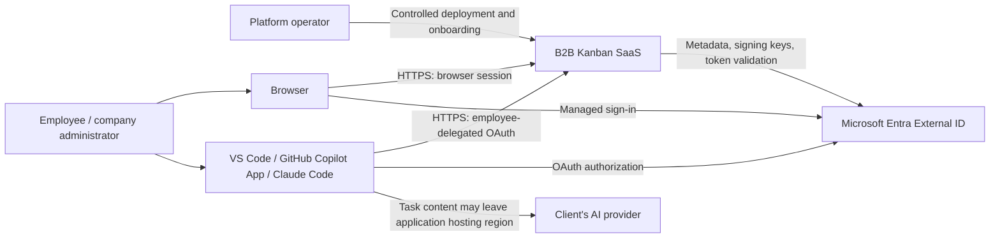
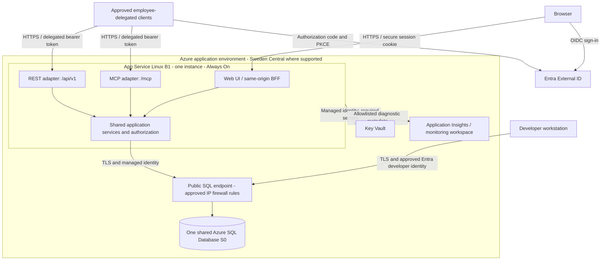
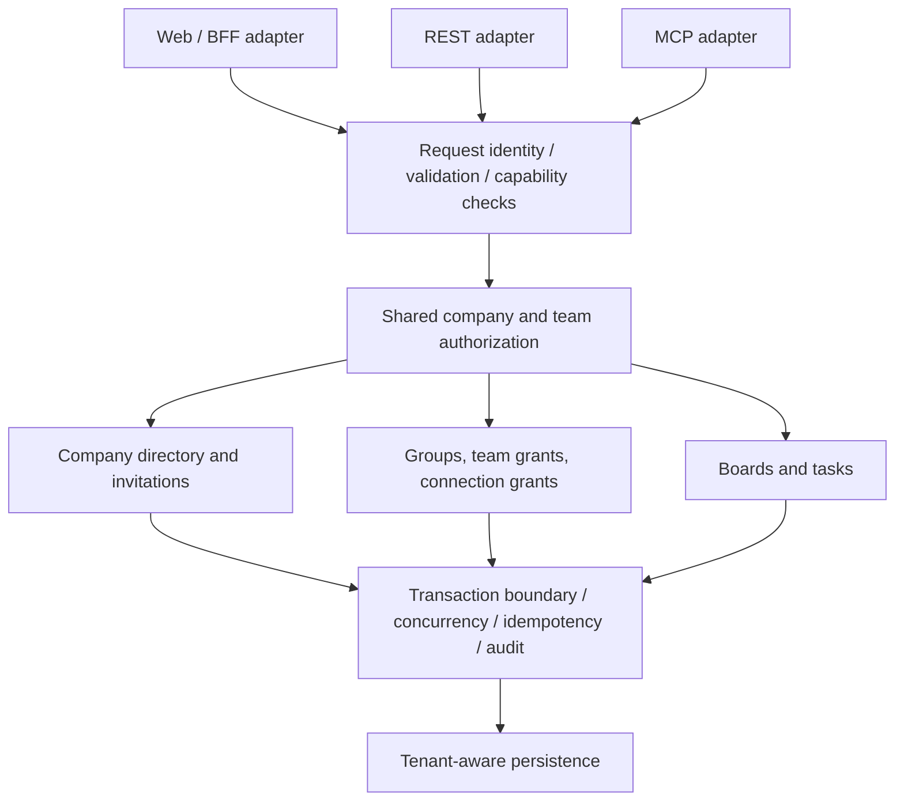
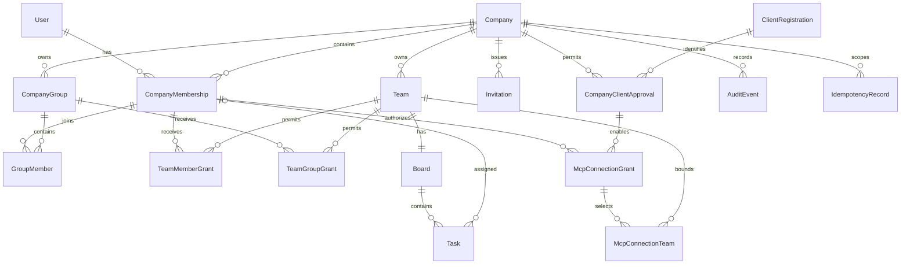
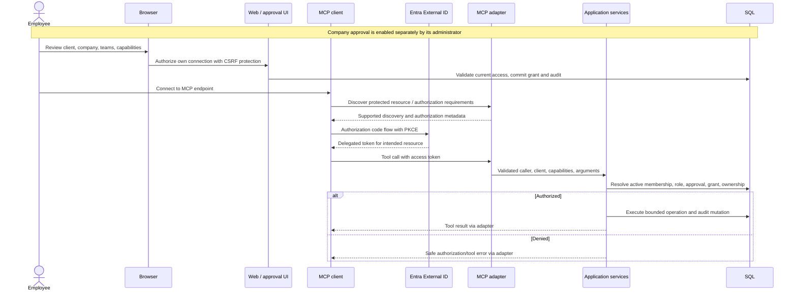

# B2B Kanban SaaS PoC: solution architecture and technical specification

Status: proposed technical design; not an implemented, integration-verified, or compliance-approved system.
Date: 2026-10-23.
Product baseline: [draft PRD](kanban-saas-prd.md).
Product extension: [self-service company onboarding PRD](kanban-saas-self-service-onboarding-prd.md); its creation/retry contracts still require technical design.
Implementation choices: [technical implementation specification](kanban-saas-implementation-spec.md).
Editable deployment view: [Excalidraw source](docs/architecture/kanban-saas.excalidraw).

## 1. Purpose, authority, and decision status

This document translates the PRD into a design for developers, technical reviewers, and operators. It combines a high-level design (HLD), implementation-level contracts (LLD), runtime views, and an architecture decision log.

The PRD remains authoritative for product scope and agreed constraints. This document must not silently expand those requirements. Where it introduces a concrete technical default, that default is **proposed**, not an additional user-approved requirement. A conflict with the PRD requires an explicit decision, not an implementation workaround.

| Label | Meaning |
| --- | --- |
| Constraint | Agreed product boundary recorded in PRD section 1 |
| Proposed | Recommended design or implementation default, pending review |
| Gate | Evidence or a decision required before dependent implementation or real-data use |
| Verified | Reserved for a linked implementation result or recorded experiment; no such claims are made here |

The technical interview selected C#/ASP.NET Core Minimal APIs, React/TypeScript, Fluent UI, and EF Core with narrowly scoped SQL. The implementation specification records the stack and engineering defaults. G1/G2 still require compatibility and hosted-runtime evidence; selecting technologies is not proof of integration. The REST examples and logical data model specify intended behavior, not generated OpenAPI, executable database migrations, or working MCP configuration.

## 2. Scope and quality goals

### 2.1 Included and excluded

The product has three entry points: a browser kanban application, an employee-delegated REST API, and a remote MCP endpoint. They use one authorization model and one set of business operations.

Included proposed MVP behavior is one board per team; To do, In progress, and Done columns; plain-text tasks; optional assignees; direct and group-based team grants; manual refresh; invitations; and audited task/access mutations. Company onboarding includes immediate verified-user self-service alongside operator-led creation, as defined in the companion onboarding PRD. Invitation links are shared through an approved channel, not a new email-delivery service.

Excluded: billing, anonymous company creation, domain claiming, attachments, comments, background integrations, service accounts, server-side AI inference, cross-company task moves/search, real-time collaboration, and permission-administration MCP tools.

### 2.2 Design envelope

| Concern | Target or constraint | Design consequence |
| --- | --- | --- |
| Workload | Up to 5 companies, 100 registered users, 10 concurrently active users | Start with one application instance and bounded relational queries |
| Dataset | Up to 10,000 tasks total; first board page at most 100 tasks | Tenant-first indexes and keyset pagination; do not load complete boards |
| Responsiveness | Ordinary backend read/write p95 under 500 ms; board load under 2 seconds | Measure at the stated workload from a nearby European client |
| Collaboration | Manual refresh; immediate feedback for the employee's own edits | No SignalR or background polling requirement; optimistic concurrency |
| Hosting | Sweden Central, where supported; application kept warm | App Service Always On and provisioned SQL |
| Isolation | Company and team isolation on every interface | Explicit ownership checks, current authorization, relational constraints, SQL RLS |
| Availability | PoC, not end-to-end high availability | Document deployment/restart interruptions and recovery limits |
| Data | Synthetic until customer approval | No assertion of production readiness, residency compliance, or regulated-data suitability |

Performance excludes interactive identity-provider sign-in, AI inference, and deliberate throttling. Browser timing includes network time. Warm hosting does not exclude platform or deployment interruptions.

### 2.3 Terminology

An application **Company** is a customer tenant; an Entra identity-directory tenant is not a Company. A global **User** can have separate **CompanyMemberships**. A **Team role** controls team content. A **delegated capability** limits a token's operations but does not grant a team role. A **connection grant** further restricts a particular employee/client/company combination.

## 3. High-level architecture

### 3.1 System context



The AI provider is outside the hosted application's trust boundary. There is no server-side LLM, Foundry resource, or Azure OpenAI requirement.

### 3.2 Container and deployment view

Here, a C4 container means an executable application or data store, not necessarily a Docker container.



The user selected a public SQL endpoint and one shared synthetic-data database for local development and the deployed PoC. Restrict SQL firewall rules to approved developer and App Service outbound IPs; require certificate-validated TLS and Entra authentication. Do not enable unrestricted IP access or the broad "Allow Azure services" exception. No SQL private endpoint, private DNS, VPN, or VNet integration is needed for this baseline. The application authenticates to SQL and Key Vault with managed identity. Migrations use a separately privileged operator/deployment identity.

No Kubernetes, container registry solely for hosting, API Management, Redis, Service Bus, SignalR, Front Door/WAF, or database-per-company is introduced initially. Any later addition needs a measured bottleneck or approved security requirement.

Identity geography, backup locations, diagnostic destinations, and AI-provider processing need separate review. A Sweden Central application deployment does not guarantee Sweden-only processing.

### 3.3 Application component view



These are modules in one deployment, not independently deployed services. Adapters call application operations rather than one another. MCP must not duplicate a task implementation or bypass authorization by calling unrestricted repositories.

## 4. Implementation boundaries

| Module | Owns | Must not do |
| --- | --- | --- |
| Identity/session | Validated identity mapping, browser session, normalized caller context | Derive app membership from email domain or token group claims |
| Directory | Companies, invitations, active/deactivated memberships | Delete the global identity when removing one company membership |
| Access | Company-scoped groups, effective team roles, company client approval, employee connection grants | Treat company administrator status as implicit content access |
| Work management | Default board, task validation, assignment, movement, version checks | Accept company/team ownership changes in mutation fields |
| Integration adapters | REST/MCP transport, capability enforcement, protocol errors | Introduce independent permission rules or shared integration secrets |
| Persistence/audit | Relational constraints, tenant context, transactions, audit records, idempotency records | Use deployment-level privileges at runtime |

Application operations receive an immutable request-scoped `CallerContext`: internal user ID, verified identity key, authentication channel, validated client-registration ID when applicable, delegated capabilities, and correlation ID. Company/team selectors are separate inputs that must be authorized.

**G2: stack verification.** The user selected C#/ASP.NET Core, feature-grouped Minimal APIs, React/TypeScript served by that same application, Fluent UI, and EF Core plus explicit security/locking SQL. Bicep is run manually; there is no GitHub Actions pipeline. Use the implementation specification's candidate versions for the G1 spike, then record the working SDK/protocol combination and App Service runtime support before feature expansion. The React SPA is an explicit choice, not a second deployment or Node.js production server.

## 5. Identity, sessions, and authorization

### 5.1 Identity mapping and browser sign-in

The identity provider handles credentials and MFA. The application does not store passwords or perform email-domain auto-join.

For the proposed Entra integration, map a verified directory ID plus immutable object ID (`tid`, `oid`) to an internal User ID. Enforce uniqueness for that pair. Do not key users by mutable email, display name, or a client-specific/pairwise `sub`. Only configured issuers and the intended resource audience are accepted.

The BFF completes OIDC authorization code flow using a maintained identity library, including state, nonce, and PKCE protections. The browser receives a Secure, HttpOnly session cookie with an appropriate SameSite policy; application access/refresh tokens are not exposed to browser JavaScript or local storage.

Persist session/protection material securely across application restarts using the selected framework's supported mechanism. A cookie proves authentication, not current company/team permission. Validate session expiry and re-resolve application membership and grants on every operation. State-changing browser requests require anti-CSRF protection.

Authentication method and MFA configuration remain provider/customer decisions. Email OTP alone is not MFA. The PRD's sign-in examples are proposals, not evidence that a policy has been configured or approved.

### 5.2 Authorization decision

For a protected team operation:

```text
allow =
  valid authenticated caller
  AND active membership in selected company
  AND selected team/resource belongs to that company
  AND current effective team role permits the action
  AND delegated capability permits the action, when using a bearer token
  AND approved, active, in-scope connection grant, when grant-bound
```

Effective team role is the maximum applicable role from direct grants and active company-scoped group memberships: Viewer < Member < Team manager. There are no nested groups or explicit-deny rules. Removing one grant does not revoke access supplied by another.

| Action | Minimum role or permission | Additional requirements |
| --- | --- | --- |
| Read board/tasks | Viewer | Active company membership; delegated read capability when applicable |
| Create/edit/move task | Member | Valid assignment; version/idempotency requirements |
| Manage team/board settings and team grants | Team manager | Principals must belong to the same company |
| Manage invitations, directory, and company groups | Company administrator | Does not expose team content |
| Create team and arrange initial manager | Company administrator | Explicit initial manager grant committed with team creation |
| Enable an AI-client registration for a company | Company administrator | No implicit employee task access |
| Authorize own connection | Employee | Company approval; team/capability subset of current access |
| Read audit records | Relevant administration permission | Company admins see access-administration events, not task activity without team access |

Audit visibility is a proposed policy: team managers may inspect their team's task and team-grant events; company administrators may inspect company-directory/client-approval events. Do not let a company-wide audit query reveal otherwise hidden task IDs or activity.

An administrator who can change group memberships or arrange explicit grants can potentially grant themselves team access. Audit this trust boundary; do not claim that explicit grants prevent administrator self-granting.

### 5.3 Delegated REST and MCP authentication

Use authorization code flow with PKCE, provider token issuance, protected-resource discovery, and the appropriate resource/audience. Validate signature, issuer, audience, lifetime, delegated scopes, and supported client registration. ID tokens, unrelated-resource tokens, app-only tokens, and user-supplied identity headers are not API credentials.

The proposed resource capabilities are `tasks.read` and `tasks.write`. `tasks.read` includes permitted-team discovery. Write-enabled connections also request read access. Provider scope names and token-claim mappings must be confirmed in G1; these logical names are not claims that a resource registration exists.

Resolve client identity from validated issuer-controlled token claims, using the provider's documented mapping. A user-editable client name or HTTP header is not sufficient. A public OAuth client ID identifies a registration; it does not authenticate a particular client binary.

### 5.4 Connection grant binding

Proposed binding: at most one active connection grant for `(CompanyId, CompanyMembershipId, ClientRegistrationId)`, with child rows selecting allowed teams. A fresh employee authorization updates that grant rather than creating ambiguous parallel grants.

Each grant records read/write capabilities, status, employee, company, client registration, creation/update times, and revocation time. Every MCP operation intersects the grant with the employee's current effective role. The employee cannot delegate access they do not currently have.

Company approval is off by default. Disabling company approval invalidates applicable connections on the next request. Removing a team from a grant affects only that team; revoking the grant blocks that connection to the company.

Grant binding must survive adapter changes. Requests using a registration designated as connection-grant-bound must enforce the same grant through REST and MCP; switching from `/mcp` to `/api/v1` must not bypass company approval or team/capability restrictions. Other delegated REST clients need a separately defined registration policy; unknown registrations are denied.

Browser connection approval is application-side authorization, not a replacement for provider OAuth authorization or provider-admin consent. The application must never build an improvised OAuth authorization server to bridge an incompatible client.

### 5.5 Revocation semantics

No long-lived authorization cache or token group claim is authoritative for app access. A request beginning after a revocation transaction commits must observe the new state. A request already authorized/in flight can finish according to its transaction ordering; revocation does not retract previously returned data or AI conversation content.

Proposed write ordering uses a company coordination row locked for the duration of task/access mutation transactions. Both access changes and protected writes take the same update lock, then re-check permissions. This intentionally coarse serialization is acceptable to evaluate at the PoC workload and prevents a write authorized against stale grants from committing after an already-committed revocation.

Read requests resolve current authorization without retaining locks across network delivery. If the low-scale locking approach misses latency targets, replace it only with a tested ordering strategy preserving these semantics.

## 6. Logical data design

### 6.1 Relationships



The exactly-one-board relationship is the product invariant after a team-creation transaction commits. Separate direct and group grant tables avoid an unenforceable polymorphic principal foreign key.

### 6.2 Entity specification

| Entity | Important fields and constraints |
| --- | --- |
| User | Internal ID; verified identity directory/object IDs, unique together; display data is not authorization evidence |
| Company | ID, name, status; coordination row for mutation ordering |
| CompanyMembership | Company ID, membership ID, User ID, status, company-admin flag; unique `(CompanyId, UserId)` |
| Team | Company ID, team ID, name; company-scoped key |
| Board | Company ID, team ID, board ID, name; unique `(CompanyId, TeamId)` |
| Task | Company/team/board IDs, task ID, title, description, status, nullable assignee membership ID, creator, timestamps, SQL rowversion |
| CompanyGroup / GroupMember | Company-scoped group; membership link uses same-company foreign keys; no nesting |
| TeamMemberGrant / TeamGroupGrant | Company/team/principal IDs, role, version; one grant per principal/team |
| Invitation | Company ID, approved normalized email, token hash, expiry, consumption/revocation state, invited-by membership ID |
| ClientRegistration | Provider registration ID, configured issuer/resource mapping, approved redirect/discovery information, channel policy; no shared desktop-client secret |
| CompanyClientApproval | Company/client key, enabled state, version, approval actor/time |
| McpConnectionGrant / McpConnectionTeam | Company/member/client binding, read/write capabilities, status/version; same-company team links |
| AuditEvent | Company, actor, client/channel, action, object/team IDs where applicable, timestamp, correlation ID; no task body |
| IdempotencyRecord | Company/member/client/operation/key, request hash, minimal create result, expiry; unique across that tuple |

All tenant-owned tables carry `CompanyId`. Use composite candidate keys and foreign keys so a valid ID from another company cannot be attached accidentally. Board/task relationships also include `TeamId`. Global User and ClientRegistration records are not tenant-owned; restrict their reads and writes through dedicated operations.

Proposed IDs are opaque, server-generated UUIDs. UUID unpredictability is not an authorization control. Timestamps are server-generated UTC. `rowversion` is an opaque concurrency token, not a timestamp or application counter.

Mutable team, board, membership, group-membership-set, grant, approval, and connection records also expose a version for conditional writes. A group's membership-set version changes whenever its member links change; it is not merely the group's display-name version.

### 6.3 Ownership, indexes, and assignment

Use tenant-first indexes, including `(CompanyId, TeamId, CreatedAt, TaskId)` for default task paging, with additional status/assignee indexes justified by measured filter queries. Index membership lookup, group links, direct/group team grants, and connection-grant bindings. Do not fetch an entire company and filter in application memory.

New/changed assignees must be active company members with effective Member or Team manager access to the team. Viewer-only access is insufficient.

User-selected lifecycle policy: retain existing assignments when access changes make the assignee ineligible, and project `assigneeState: inactive` from current membership/effective contributor access. Unrelated task edits remain possible. New/changed assignments still require active contributors. Access changes are audited; the assignment reference never restores access. Company administrators may explicitly appoint a replacement for a managerless team without receiving its content.

### 6.4 SQL row-level security

RLS is company isolation defense in depth, not team authorization:

1. Resolve the verified user and active company membership through a narrow bootstrap operation.
2. Acquire a database connection and establish the authorized `CompanyId` in SQL session context before tenant data access.
3. Apply filter predicates for reads and block predicates for inserts/updates, including attempted ownership changes.
4. Initialize context on every logical connection checkout and clear it before return to the pool. Missing/invalid context denies tenant access.
5. Re-check membership/roles inside protected write transactions; do not rely only on the initial bootstrap result.

Do not rely on an assumed implicit driver reset or make pooled session context immutable in a way that prevents safe reuse. If cleanup fails, discard the connection rather than returning potentially contaminated state to the pool.

Company discovery and membership validation cannot depend on a tenant context that has not yet been authorized. Proposed bootstrap implementation: dedicated stored procedures for active-company discovery and membership resolution, under a restricted execution principal whose directory-only RLS exception is unavailable to ordinary runtime queries. No caller-settable bypass flag, unrestricted directory read, runtime impersonation permission, or task-table bypass is allowed.

G3 must demonstrate that bootstrap/RLS/pooling behavior with the selected driver, including exceptions, rollback, cancellation, reused connections, and parallel requests for different companies. The runtime principal is not a database owner and cannot alter policies. RLS does not protect against a fully compromised application or privileged operator.

## 7. REST contract

### 7.1 Shared conventions

Base path: `/api/v1`. JSON uses camelCase. All company/team IDs in routes are selectors, not permission proofs. Route ownership and field allowlists are checked before persistence.

| Concern | Proposed contract |
| --- | --- |
| Authentication | BFF session for browser calls; validated delegated bearer token for explicitly supported API routes |
| Session-only routes | Directory, grants, approvals, connection management, and audit administration; no delegated access-administration capability in the PoC |
| Pagination | `limit` defaults to 50, range 1-100; opaque `cursor`; return `items` and nullable `nextCursor` |
| Cursor binding | Bind to company, team, filters, sort order, and last key; validate integrity and bounded length; reauthorize every page |
| Sort | Immutable `createdAt` descending, then task ID; pagination is not a historical snapshot |
| Filtering | Task status and assignee; an explicit unassigned filter is mutually exclusive with a specific assignee |
| Concurrency | Strong quoted ETag containing the opaque version; `If-Match` required for updates/moves and versioned access changes |
| Conditional creation | A create-or-update management PUT requires `If-None-Match: *` for creation or `If-Match` for update; never perform an unconditional grant replacement |
| Create retry | `Idempotency-Key` required for task creation; bounded opaque ASCII key, proposed length 16-128 |
| Task text | Trimmed title 1-200 characters; description 0-10,000 characters; plain text, not HTML/Markdown execution |
| Ownership | Mutations never accept company/team/board ownership reassignment |
| Partial update | Omitted field unchanged; `assigneeMembershipId: null` clears assignment; title/description cannot be null |
| Request bounds | Proposed task-operation JSON body maximum 64 KiB; independently bound strings and collection counts |
| Correlation | Server-generated correlation ID returned with responses and safe errors |

Use one documented Unicode length convention in browser/server schemas after G2. Do not let different code-unit counts produce contradictory limits. The first board load contains at most 100 tasks total, not 100 per column; visibly offer further loading and label counts as loaded counts unless separately calculated.

### 7.2 Route inventory

| Method and route | Purpose and authorization |
| --- | --- |
| `GET /companies` | List only the caller's active company memberships |
| `GET /companies/{companyId}/teams` | List only permitted teams; delegated callers also need read capability and any applicable connection grant |
| `POST /companies/{companyId}/teams` | Company administrator creates team, default board, and explicit initial manager grant atomically |
| `PATCH /companies/{companyId}/teams/{teamId}` | Team manager updates allowlisted team settings |
| `GET /companies/{companyId}/teams/{teamId}/board` | Viewer reads the default board definition |
| `PATCH /companies/{companyId}/teams/{teamId}/board` | Team manager updates allowlisted board settings; fixed column semantics remain unchanged |
| `GET /companies/{companyId}/teams/{teamId}/tasks` | Viewer reads a bounded, filtered task page |
| `GET /companies/{companyId}/teams/{teamId}/tasks/{taskId}` | Viewer reads one owned task |
| `POST /companies/{companyId}/teams/{teamId}/tasks` | Member creates task with an idempotency key |
| `PATCH /companies/{companyId}/teams/{teamId}/tasks/{taskId}` | Member updates title, description, or assignee with expected version |
| `POST /companies/{companyId}/teams/{teamId}/tasks/{taskId}/moves` | Member changes status within the same team/board with expected version |
| `GET /companies/{companyId}/memberships` | Company administrator lists the company directory; team managers use a separate minimal grant-candidate lookup |
| `PATCH /companies/{companyId}/memberships/{membershipId}` | Company administrator deactivates/reactivates membership using expected version; no global identity deletion |
| `POST /companies/{companyId}/invitations` | Company administrator creates a bounded, expiring invitation; raw link returned only at issuance |
| `POST /companies/{companyId}/invitations/{invitationId}/revocations` | Company administrator revokes an unused invitation |
| `POST /invitations/accept` | Authenticated, verified-email recipient atomically consumes the token; no membership required beforehand |
| `GET /companies/{companyId}/groups` | Company administrator lists company groups |
| `POST /companies/{companyId}/groups` | Company administrator creates company group |
| `PUT /companies/{companyId}/groups/{groupId}/members` | Company administrator replaces a bounded set of same-company members with expected version |
| `GET /companies/{companyId}/teams/{teamId}/grant-candidates` | Team manager obtains minimal active member/group IDs and display labels for that company |
| `GET /companies/{companyId}/teams/{teamId}/grants` | Team manager reads explicit grants |
| `PUT /companies/{companyId}/teams/{teamId}/grants/{principalType}/{principalId}` | Team manager creates/updates an explicit member/group grant using conditional creation or expected version |
| `DELETE /companies/{companyId}/teams/{teamId}/grants/{principalType}/{principalId}` | Team manager removes that grant with expected version; other access sources remain effective |
| `GET /companies/{companyId}/teams/{teamId}/effective-access/{membershipId}` | Team manager inspects effective role and contributing sources |
| `GET /companies/{companyId}/client-approvals` | Company administrator reviews configured registrations and company approval |
| `PUT /companies/{companyId}/client-approvals/{clientRegistrationId}` | Company administrator enables/disables a known registration using conditional creation or expected version |
| `GET /companies/{companyId}/connections` | Employee lists their own connection grants, never other employees' grants |
| `PUT /companies/{companyId}/connections/{clientRegistrationId}` | Employee authorizes/updates their own team/capability subset with conditional creation or expected version |
| `DELETE /companies/{companyId}/connections/{clientRegistrationId}` | Employee revokes their own connection with expected version |
| `GET /companies/{companyId}/audit-events` | Permission-filtered, bounded audit query; task activity requires relevant team permission |

Non-task management create routes are session-only and protected against double-submit, but do not inherit the task idempotency contract unless explicitly added to the generated API schema.

Team managers need minimal company member/group lookup to grant access; this does not grant company-directory administration. Do not return full directory profiles or other teams' grants.

### 7.3 Task shapes

```text
Task {
  id, companyId, teamId, boardId,
  title, description,
  status: "todo" | "inProgress" | "done",
  assigneeMembershipId: UUID | null,
  createdAt, updatedAt, version
}

CreateTask {
  title, description = "", assigneeMembershipId = null
}
CreateTaskResult { taskId, version, createdAt }

UpdateTask {
  title?, description?, assigneeMembershipId?
}
MoveTask { targetColumn: "todo" | "inProgress" | "done" }

TaskPage { items: Task[], nextCursor: string | null }
```

New tasks start in To do. Updates cannot change status; use the move operation. No within-column ordering or cross-board movement is promised.

Create returns `201`, a resource `Location`, and `CreateTaskResult`; GET retrieves the full representation. Updates/moves return the confirmed Task and new ETag. Version values in JSON and ETag encode the same database version.

Before implementing routes, publish OpenAPI with exact types, required/nullable fields, conditional-request behavior, security alternatives, bounds, and errors. This route inventory is not a substitute for that machine-readable artifact.

### 7.4 Idempotency and conflicts

Task creation records the unique tuple `(company, member, client-or-browser-channel, operation, key)` and a hash of canonical validated fields in the mutation transaction. A same-key/same-request retry returns the original minimal create result without another task or audit mutation. A same-key/different-request retry returns a conflict.

Always reauthorize a replay. Never return another principal's idempotency result. Proposed retention is 24 hours; after expiry the key no longer guarantees deduplication. Store only task ID, version, creation time, and required response metadata, not a second task description. A replay is the original create result; GET obtains any later state.

For updates, compare the expected rowversion as part of the database update predicate. Zero affected rows must be distinguished safely between an inaccessible/missing resource and a stale version. Never silently apply a stale edit or retry it against a fresh version.

### 7.5 Errors

REST errors use `application/problem+json`, with `type`, `title`, `status`, a safe `detail`, stable application `code`, and `correlationId`. Do not include tokens, task bodies, SQL text, stack traces, or cross-tenant object details.

| HTTP status | Meaning |
| --- | --- |
| 400 | Malformed input, invalid cursor, or unsupported field |
| 401 | Missing/invalid/expired authentication; never turn an API failure into a successful HTML response |
| 403 | Authenticated caller lacks an operation permission within an already visible scope |
| 404 | Company/team/task is absent or not visible; avoid existence oracles |
| 409 | Idempotency-key reuse with different content, duplicate constraint, or business-state conflict |
| 412 | Expected version is stale, or a conditional-create resource already exists |
| 413 | Body exceeds the supported bound |
| 428 | Required mutation precondition is missing |
| 429 | Rate/concurrency limit reached; include retry guidance |
| 500 / 503 | Unexpected failure or unavailable dependency; no success-shaped fallback |

## 8. MCP contract and compatibility gate

Use the official SDK and stateless Streamable HTTP at `/mcp` for bounded request/response tools. Select and pin the protocol/SDK versions after G1. Enforce applicable Origin, transport, and discovery requirements through supported library facilities; absence of a browser Origin header does not bypass OAuth.

| Tool | Inputs | Output | Capability and role |
| --- | --- | --- | --- |
| `list_teams` | `companyId` | Bounded teams page; add `cursor`/`limit` as optional arguments | Read; permitted teams only |
| `list_tasks` | `companyId`, `teamId`, optional filters/cursor/limit | TaskPage | Read + Viewer |
| `get_task` | `companyId`, `teamId`, `taskId` | Task | Read + Viewer |
| `create_task` | `companyId`, `teamId`, CreateTask fields, `idempotencyKey` | CreateTaskResult | Write + Member |
| `update_task` | Company/team/task IDs, UpdateTask fields, `expectedVersion` | Task | Write + Member |
| `move_task` | Company/team/task IDs, `targetColumn`, `expectedVersion` | Task | Write + Member |

All tools additionally require active company approval and an active employee connection grant. Tools do not accept arbitrary URLs, raw SQL, caller identity overrides, company/team reassignment fields, permission changes, or bulk-write arrays.

Inputs and outputs use the REST domain shapes, bounds, validation, idempotency, and concurrency semantics. Publish exact JSON Schemas when implementing the SDK registration. Reject unknown mutation fields. The bounded `list_teams` extension is a proposed technical refinement of the PRD's minimal signature.

Authentication failures are transport-level authorization failures. Invalid tool arguments use protocol-standard validation errors. Authorized execution failures produce SDK-supported tool errors with a stable domain code, safe message, and correlation ID; a version conflict uses `VERSION_CONFLICT`, not an apparently successful task result. Return structured task data with safe textual content as required by the selected SDK/client combination.

Treat titles, descriptions, and all tool-returned text as untrusted data, not agent instructions. Client confirmations and tool annotations are useful UX, never the authorization boundary.

### G1: prove the exact client/provider path first

| Client | Exact version | Registration / callback / discovery | Read/write | Renewal | Revocation |
| --- | --- | --- | --- | --- | --- |
| VS Code | To record | To demonstrate | Not verified | Not verified | Not verified |
| GitHub Copilot App | To record | To demonstrate independently of Copilot CLI | Not verified | Not verified | Not verified |
| Claude Code | To record | To demonstrate | Not verified | Not verified | Not verified |

Record issuer/resource configuration, supported client-registration mechanism, callback behavior, scope/claim mapping, expiry/renewal behavior, and sanitized evidence. Exercise company/team subset enforcement and denial after membership, team grant, company approval, and connection-grant revocation.

Do not assume dynamic registration support or equivalent behavior across clients. If any required client/provider combination is incompatible, stop dependent integration work and record an explicit product/identity decision. Do not use a shared API key, distribute a desktop-client secret, or pass through an unrelated token to disguise incompatibility.

## 9. Runtime views

### 9.1 Employee invitation acceptance

The invitation token is cryptographically random, time-limited, single-use, and stored as a hash. Choose a bounded lifetime in G3. Verify ownership of the approved address using trusted provider verification evidence or an explicit application-controlled verification step; a display email claim alone is insufficient.

An authenticated acceptance transaction checks expiry/revocation, verified-address match, and existing membership, then consumes the invitation and creates/reactivates only the intended membership, with an audit event. Lock consumption so parallel requests cannot admit twice. Acceptance does not grant team access unless an explicit, audited team grant is separately arranged.

Do not put invitation tokens in analytics, referrer headers, or application request logs. The acceptance UI must scrub the token from the address bar after exchange and apply an appropriate referrer policy. Repeated or wrong-recipient attempts receive safe errors.

### 9.2 MCP connection and task use



The diagram shows two distinct authorizations, not a claim that all clients provide an identical combined consent journey. The spike must determine how the employee reaches the application-side approval UI. No process-global or mutable session-global "current company" is used.

### 9.3 Version-aware mutation

```mermaid
sequenceDiagram
    participant Caller as Browser / REST / MCP
    participant Adapter
    participant Core as Task service
    participant DB as SQL
    Caller->>Adapter: Edit or move with expected version
    Adapter->>Core: Validated caller, selected company/team, allowed fields
    Core->>DB: Resolve membership and establish tenant context
    Core->>DB: Begin transaction; lock company coordination row
    Core->>DB: Re-check current role, grant, ownership, assignment
    alt Permission and version valid
        Core->>DB: Conditional update and metadata-only audit insert
        Core->>DB: Commit
        Core-->>Caller: Confirmed task and new version via adapter
    else Stale version
        Core->>DB: Roll back
        Core-->>Caller: Explicit conflict via adapter
    else Permission lost
        Core->>DB: Roll back
        Core-->>Caller: Safe denial via adapter
    end
```

The UI preserves an unsaved draft on conflict and offers loading the latest version. It does not silently overwrite or automatically reapply the draft. Display success only after server confirmation.

### 9.4 Offboarding

```mermaid
sequenceDiagram
    actor Admin as Company administrator
    participant App
    participant DB as SQL
    participant Caller as Employee browser / API / MCP
    Admin->>App: Deactivate company membership
    App->>DB: Begin transaction; lock company coordination row
    App->>DB: Verify administrator; deactivate selected membership
    App->>DB: Apply approved assignment policy; insert audit events
    App->>DB: Commit
    App-->>Admin: Deactivation confirmed
    Caller->>App: Next request for that company
    App->>DB: Resolve current company membership
    DB-->>App: Inactive
    App-->>Caller: Access denied; no company data returned
    Note over App,DB: Other company memberships and global identity remain unchanged
```

Inactive membership overrides all team/group grants and connection records. User-confirmed reactivation behavior restores membership only: historical grants/connections are non-authorizing, team/group access requires fresh grants, administrator status requires explicit reappointment, and MCP use requires fresh connection authorization. Assignment-loss handling remains a separate G3 decision.

## 10. Browser behavior

The browser always shows selected company/team and effective team role. Hide administrative navigation unless its permission exists, but enforce all policies on the server.

Switching company cancels pending requests and clears previous company data. Associate responses with the originating company/team and discard late results after switching. Do not let a slow response repopulate another company's screen. Warn before abandoning an unsaved draft.

A successful empty response shows an empty state. Authentication failures, denials, throttling, conflicts, and dependency failures have distinct states, not empty boards. Viewer controls remain read-only. Moving a task has a keyboard-accessible action in addition to dragging.

Refresh loads current data and versions. Returning from a successful mutation updates that task immediately without claiming that another employee's board has synchronized. Company switching and sign-out must not leave sensitive cached views accessible as current data.

## 11. Security and failure design

| Boundary or failure | Required design response |
| --- | --- |
| Guessing company/team/task IDs | Validate ownership and authorization on every query, join, filter, assignment, and tool call |
| Missed tenant predicate | Same-company foreign keys plus company RLS filter/write-block predicates |
| Stale or forged permissions | Current database grants; validated tokens; no client-provided caller identity |
| MCP-to-REST downgrade | Registration-bound restrictions apply across adapters |
| Browser CSRF/XSS | Anti-CSRF, appropriate cookie policy, CSP, escaped plain text, no tokens exposed to JavaScript |
| Untrusted task instructions | No elevated server action or permission decision based on task content |
| Dependency outage | Bounded timeout and safe failure; no empty-success response |
| Transient SQL failure | Bounded retries only for known transient conditions and retry-safe complete operations; never retry a stale edit against a new version |
| Audit insert failure | Roll back the protected business/access mutation |
| Noisy neighbor | Bounded pages/inputs plus per-user/company rate and concurrency limits |
| Diagnostic leakage | Allowlisted metadata; redact credentials, task text, invitation tokens, headers, and request bodies |
| Privileged support | Controlled, time-bounded exceptional access; audit changes; no hidden application content bypass |

Choose initial rate/concurrency limits before G4 and record them with the load profile. Throttling is explicit and must not be used to make the 10-user performance target pass by refusing ordinary load.

Audit records contain actor, company, action, channel/client, object/team IDs, timestamp, and correlation ID. Capture access changes and task mutations in the same transaction as their business changes. Task descriptions and authentication tokens never enter audit payloads.

Rejected authorization attempts can generate separate restricted security diagnostics with safe metadata. Database audit tables are not tamper-proof compliance storage. Access to logs and audit data is itself permission-controlled.

## 12. Deployment and operations

### 12.1 Environment and identities

Use workstation-invoked Bicep for App Service/plan, managed identities, one SQL logical server/database with approved public firewall rules, Key Vault, and monitoring. Keep parameterized environment configuration separate from secrets. One deployed synthetic-data environment shares its database with local development; do not provision a second development/CI database or private-network resources by default. The existing External ID tenant is an external prerequisite and is not created by the application deployment.

| Identity | Access |
| --- | --- |
| Runtime managed identity | Restricted SQL runtime operations and only required Key Vault secrets |
| Deployment/migration identity | Controlled schema migrations and infrastructure deployment; not used for normal requests |
| Platform operator | Controlled company seeding, initial administrator appointment, deployment and recovery |
| Employee | Provider-managed sign-in and application permissions only |

Runtime managed identity is hosting infrastructure, not unattended employee integration access. It does not introduce service-account API/MCP support.

If the selected confidential web client requires a credential, keep it in Key Vault using the provider's supported mechanism. Public desktop clients do not receive that credential.

### 12.2 Releases and recovery

Keep Always On enabled. Verify SQL TLS/authentication and the actual App Service outbound-IP firewall rules before opening the release to users. Refresh the allowlist after hosting changes that alter egress IPs. Build, test, migrate, and deploy using documented workstation commands, not GitHub Actions. Do not assume a particular deployment-slot capability on the selected tier.

Use backward-compatible expand/contract migrations where practical. Record a maintenance interruption when a change cannot be rolled out compatibly. Application rollback is not a database rollback; do not automatically run destructive down-migrations.

SQL restore is database-wide. Restore into an isolated recovery database and verify before considering controlled company-specific extraction. Never overwrite the shared live database to recover one company's tasks.

Normal operation has one database. A temporary isolated recovery database is an explicit exception needed for a restore exercise, not a permanently provisioned second environment. Tests use dedicated, run-scoped synthetic fixtures in the shared database and must never call database reset/drop or clean unrelated data.

Record backup policy, retention, recovery point objective, recovery time objective, and a timed restore exercise before real-data approval. No numeric RPO/RTO or customer SLA is promised by this PoC.

### 12.3 Health, telemetry, and cost

Provide a minimal public liveness endpoint and platform-restricted readiness/dependency checks. Expose neither internal configuration nor dependency credentials. Readiness checks must be bounded and non-mutating.

Track request latency by adapter/operation, error rates, SQL duration, throttling, concurrency conflicts, and authorization-denial trends. Avoid task IDs as high-cardinality metric labels; use restricted correlated traces where investigation needs object IDs.

Use the PRD's approximately $40-70/month whole-environment allowance only as a preliminary estimate, not a fresh quote or cap. Validate selected SKUs, networking, monitoring, authentication extras, and environment count before provisioning. Budget alerts do not stop spending.

## 13. Verification and requirement traceability

All entries below are planned evidence, not completed tests.

The approved PoC delivery uses one small safety-test project plus focused deployed browser/REST/MCP checks. The user explicitly deferred V11 restore proof and the formal V12 benchmark; both remain unverified, and no temporary recovery database is created. The at-most-100-task first-page bound still applies.

| Evidence ID | PRD reference | Required evidence |
| --- | --- | --- |
| V1 | Sections 2, 3, 9 | Administrator invites employee, grants a group team access, employee creates/moves task through browser |
| V2 | Sections 4, 6, 9 | Two companies share a User identity; changed IDs, routes, filters, payloads, cursors, and MCP arguments never expose unauthorized data |
| V3 | Sections 4, 9 | No team grant denies reads; Viewer denies every mutation across UI, REST, and MCP |
| V4 | Sections 4, 7, 9 | Direct-plus-group maximum role; removing one source preserves other grants; removing last source denies next request |
| V5 | Sections 2, 7, 9 | Membership, company approval, team-scope, and connection revocation observed on next request; concurrent writes follow defined ordering |
| V6 | Sections 6, 7, 9 | Exact versions of all three clients prove sign-in, task read/write, renewal, and revocation; no shared-key fallback |
| V7 | Sections 3, 7, 9 | Simultaneous edit/move with the same version permits one mutation; loser receives explicit conflict and browser draft remains |
| V8 | Sections 6, 7 | Create retries and parallel retries create one task/audit mutation; different request with same key conflicts; replay reauthorizes |
| V9 | Sections 4, 6 | RLS read/write denial and pooling/cancellation tests; directory bootstrap cannot become a general tenant bypass |
| V10 | Sections 4, 6, 9 | Audit identity/client/company/action are correct; audit failure rolls back mutation; logs contain no task text/tokens |
| V11 | Sections 5, 9 | Deferred by user: isolated restore verification and timing; do not claim recovery proof |
| V12 | Section 9 | Formal benchmark deferred by user: 10 users/10,000 tasks and latency targets unverified; retain at-most-100-task first page |
| V13 | Section 8 | Late responses discarded after company switch; accessible movement; errors distinguished from empty state; no stale-edit overwrite |
| V14 | Sections 4, 7 | Company admin without a team grant cannot read tasks through task routes, audit queries, grant lookups, or MCP |
| V15 | Sections 6, 7 | Grant-bound registration cannot avoid approval/team restrictions by calling REST directly |

Exercise the selected negative cases at real adapter boundaries, not only mocked authorization helpers. The focused SQL checks use restricted runtime-equivalent permissions and recorded run-owned fixtures. Complement them with deployed browser/API/MCP behavior; no broad unit/component/browser suite or coverage target is required.

For latency evidence, state dataset distribution, query/filter mix, measurement duration, client location, warm-up policy, and percentile calculation. Include complete operations such as create plus its audit/idempotency work. Report deployment interruptions and throttling separately rather than hiding them in an average.

## 14. Architecture decision records

These are compact ADRs inside the document. Extract them into separately versioned files if the decision history grows. ADR-001 through ADR-004 remain proposed unless separately accepted. ADR-005 and ADR-006 record user-selected refinements; that acceptance does not claim deployment or compatibility evidence.

### ADR-001: modular monolith on warm App Service

**Context:** Three interfaces need identical permission/business rules at a small PoC workload.

**Decision:** Propose one application deployment, shared services, App Service Linux B1 with Always On, and a built-in supported runtime.

**Consequences:** Low operational overhead and no distributed transactions. Releases/restarts can interrupt all interfaces. Module boundaries must remain explicit; scale only after measuring.

### ADR-002: shared relational database with layered tenant isolation

**Context:** Companies share global identities but own memberships, teams, grants, and tasks.

**Decision:** Propose provisioned SQL S0 with a shared schema, same-company relational constraints, application team authorization, and company RLS.

**Consequences:** Simple transactions and predictable warm database cost. Shared capacity/blast radius; per-company recovery is not a direct restore operation. Tenant context, pooling, and bootstrap need explicit verification.

### ADR-003: managed identity provider, browser BFF, delegated integrations

**Context:** The browser and AI clients act for employees; no unattended integration identity is allowed.

**Decision:** Propose Entra External ID, same-origin BFF sessions, provider-issued delegated tokens, and current server-side application permissions.

**Consequences:** No application passwords or desktop shared secret. Exact OAuth discovery/registration/callback/renewal compatibility is a blocking experiment, not an assumption. Identity geography remains a separate review.

### ADR-004: grant-bound task tools over shared application operations

**Context:** AI-client task access needs company approval and employee-selected team/capability bounds.

**Decision:** Propose a small stateless MCP tool set, one unambiguous connection binding per employee/company/registration, and shared REST/MCP task operations with cross-adapter grant enforcement.

**Consequences:** No access-administration or bulk-write tools. Token scopes alone never grant team access. Public registration IDs do not prove client-binary authenticity; company approval must acknowledge that limit.

### ADR-005: one public-endpoint SQL database, including local development

**Status:** User-selected during the technical interview, 2026-10-23.

**Decision:** Use one Azure SQL database/logical server for the deployed synthetic-data PoC and local development. Use a public endpoint with narrow firewall rules, TLS, and Entra authentication. Do not introduce a separate development database, private endpoint, VPN, or CI environment.

**Environment exception (user-directed, 2026-10-23):** The selected subscription's SQL network policy recognizes `SecurityControl=Ignore` on the resource group. The user explicitly requested this tag on `rg-kanban-poc-swc`; deployment tooling merges it only into that group in apply mode. Public SQL access and a read-only Entra/TLS connection were subsequently verified. This synthetic-PoC exception does not remove the narrow firewall, certificate validation, or Entra authentication requirements and must be reviewed before any real-data use.

**Consequences:** Fewer resources and direct workstation connectivity for migrations. Public network exposure, outbound-IP changes, shared-schema migration risk, and non-destructive test fixtures need explicit handling. A restore exercise still needs a temporary isolated recovery database.

### ADR-006: selected implementation stack and manual tooling

**Status:** User-selected during the technical interview, 2026-10-23.

**Decision:** C#/ASP.NET Core Minimal APIs, React/TypeScript served by the same host, Fluent UI, EF Core plus narrow SQL, and manually invoked Bicep. No GitHub Actions. Reuse the user-created External ID tenant; retain unknown directory/app identifiers as prerequisites rather than inventing them.

**Consequences:** One production deployment, with .NET and Node tooling on the workstation. The implementation specification governs project structure, versions, package feed, configuration, and manual checks. Identity/client and hosted-runtime verification are still gates.

## 15. Delivery gates and unresolved decisions

| Gate | Required output | Blocks |
| --- | --- | --- |
| G1: accepted identity baseline | Preserve the existing working provider configuration and session boundary; no renewed MFA/provider-policy project | Identity redesign is outside the approved product implementation; actual three-client functional support is still verified under G4/V6 |
| G2: implementation stack | Recorded stack, exact dependency/protocol versions, persistent sessions, and hosted runtime evidence | Deploying an unverified runtime or claiming unsupported dependency compatibility, not building UI on the accepted baseline |
| G3: domain/isolation design review | Executable schema/RLS prototype; bootstrap/pooling proof; invitation verification/lifetime; assignment-loss and reactivation decisions; conditional mutation rules | Feature implementation relying on those invariants |
| G4: synthetic-data PoC acceptance | Contracts, full V6 read/write/renewal/revocation matrix, other functional/security evidence, limits, deployment procedure, cost, and explicit V11/formal-V12 deferrals | Declaring the PoC demonstrated |
| G5: real-data approval | Customer review of data classification, contracts, AI destinations/terms, identity/residency, retention/deletion/export, authentication, recovery/support/incident controls | Any real confidential or regulated data |

Managerless-team recovery is confirmed: company administrators can appoint an eligible replacement through an explicit audited grant, without receiving board/task access. Urgent offboarding is not blocked to preserve a manager. The implementation and current local/deployed evidence are recorded in section 13.4 of the implementation specification; G4 remains incomplete while authenticated product/client acceptance is unavailable.

The implementation must publish the machine-readable contracts and infrastructure/migration sources alongside this design, and update the decision status with evidence. Creating this document does not satisfy any deployment, interoperability, performance, security, or compliance gate.

## References

- [Product requirements, constraints, acceptance criteria, and source links](kanban-saas-prd.md).
- [Selected stack, local configuration, and engineering implementation](kanban-saas-implementation-spec.md).
- [Editable deployment architecture](docs/architecture/kanban-saas.excalidraw).
- [arc42 structure](https://arc42.org/overview).
- [C4 model](https://c4model.com/).

Vendor-specific proposals inherit the PRD's cited sources. Their availability, compatibility, and prices must be rechecked during the relevant delivery gate; this document does not independently certify those external claims.
